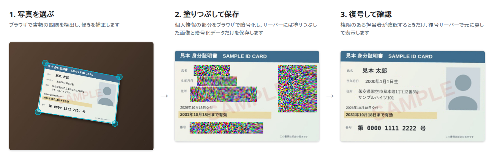

# sealpix

Web サービスで本人確認書類などの画像をアップロードするときに、氏名や番号などの個人情報が写った部分を、ブラウザ上で暗号化してから送信するためのライブラリです。既存の Web サービスに組み込んで使います。



画面は、架空の見本の書類で動かした例です。

> **0.x の間は、仕様が予告なく変わることがあります。**
>
> **第三者によるセキュリティ監査は受けていません。**

## 概要

- ブラウザ上で、画像のうち個人情報が写った部分を塗りつぶし、元の部分は公開鍵で暗号化します。暗号化する前の画像がブラウザの外に送られることはありません。
- サーバーには、塗りつぶした画像と暗号化データの2つを保存します。
- 元の画像を確認する必要があるときだけ、秘密鍵を持つ復号サーバーで復号し、権限のある運営側のユーザーが確認します。
- 復号サーバーは、sealpix を導入するサービスが自分で運用します。秘密鍵を外部のサービスに預ける必要はありません。

## 暗号化の対象（予定）

| 対象                                     | 説明                                                                                                           | 予定       |
| ---------------------------------------- | -------------------------------------------------------------------------------------------------------------- | ---------- |
| 画像全体（`whole`）                      | 画像全体を暗号化します。テンプレートがない書類にも使えます                                                     | 初版       |
| テンプレートで指定した項目（`template`） | 書類の種類ごとに項目の位置を定義したテンプレートと、どの項目を暗号化するかを決めたポリシーに従って暗号化します | 初版       |
| ユーザーが指定した範囲                   | 画像をアップロードするユーザーが、画像上で範囲を指定します                                                     | 初版より後 |

## 構成

|                           | 内容                                                                                                                                | 状態     |
| ------------------------- | ----------------------------------------------------------------------------------------------------------------------------------- | -------- |
| `packages/core`           | 暗号化データの作成と復号、鍵ペアの作成と読み込み、入力値の検証                                                                      | 実装済み |
| `packages/browser`        | 画像の選択、書類の傾きの補正、塗りつぶし、暗号化、復号した画像の表示（Web Components、[使い方](packages/browser/README.md)）        | 実装済み |
| テンプレートエディター    | 見本画像の上で項目の位置を指定して、テンプレート（JSON）を作成する画面（`packages/browser` に含まれます）                           | 実装済み |
| `templates`               | 運転免許証（表・裏）のテンプレートと、ポリシーの例（[説明](templates/README.md)）                                                   | 実装済み |
| `packages/decrypt-server` | 秘密鍵で復号し、誰がいつ復号したかをログに残します。画像は保存しません（[使い方](packages/decrypt-server/README.md)）               | 実装済み |
| `packages/inspect-server` | 保存する前に画像を作り直し、塗りつぶしが漏れていないことを保証します。鍵は持ちません（[使い方](packages/inspect-server/README.md)） | 実装済み |
| `examples`                | アップロードから復号までの流れを試せる見本のバックエンドと、Docker Compose の設定（[試し方](examples/README.md)）                   | 実装済み |

## 暗号化データの形式

JWE（RFC 7516）の Flattened JSON Serialization です。JOSE に対応したライブラリがあれば、どの言語でも復号できます。

- 鍵の暗号化: `RSA-OAEP-256`（3072 ビット以上の RSA 鍵）
- 内容の暗号化: `A256GCM`
- `kid`: 公開鍵の JWK Thumbprint（RFC 7638）
- protected ヘッダーの `sealpix` パラメーターには、形式のバージョン、暗号化の対象、画像サイズ、暗号化した範囲の座標が入ります。protected ヘッダーは暗号化されませんが、改ざんされると復号に失敗します。
- 暗号化される内容は、範囲ごとの切り出し位置と、範囲を囲む四角形を切り出した JPEG 画像です。四角形の中で範囲の外にあたる部分は、塗りつぶした画像に写っている部分か、同じ暗号化データに入るほかの範囲の一部です。

アップロードの大きさの目安: 見本のバックエンドへの送信（暗号化データと塗りつぶした画像を入れた JSON）は、運転免許証のテンプレートで約 0.3〜0.4 MB です。画像全体の暗号化（長い辺を 2000 ピクセルに縮めます）は写真によって大きく変わり、2 MB 近くになることがあります。前に置く WAF やリバースプロキシの本文の上限は、余裕をもって数 MB 以上にしてください（nginx の `client_max_body_size` は既定で 1 MB です）。

## セキュリティについて

設計上の目標です。未実装の内容を含みます。

sealpix で防げること:

- 保存した画像やデータが漏えいしても、秘密鍵がなければ暗号化した部分は見られません。
- 保存する画像は画像検証サーバーで塗りつぶし直すため、塗りつぶしが漏れた画像は保存されません。
- 誰がいつ復号したかがログに残ります。

sealpix では防げないこと:

- 画像をアップロードするユーザーが、暗号化する画像を別の画像に差し替えること。サーバーは元の画像を受け取らないため、暗号化された内容が本物かどうかは確認できません。復号して確認するときに、目視で確かめてください。
- 復号サーバーの秘密鍵の漏えい。
- 復号した画像を、導入したサービス側で保存されたり、画面をキャプチャされたりすること。
- 暗号化の対象外の部分に写っている情報。テンプレートが書類と合っていない場合は、個人情報が暗号化されずに残ります。

権限の管理、復号した画像の扱い、秘密鍵の保管とバックアップは、導入するサービス側の責任です。秘密鍵をなくすと、それまでの暗号化データは復号できなくなります。鍵の切り替え方と古い鍵の削除の手順は、[復号サーバーの説明](packages/decrypt-server/README.md#鍵の切り替え)を参照してください。

## 試してみる

Docker Compose で一式を手元に立ち上げて試せます。手順は [examples/README.md](examples/README.md) を参照してください。

## 開発

Node.js 24.15 以上と npm 11 が必要です。

```bash
npm install
npm test
npm run typecheck
```

結合テスト（Playwright）は次のコマンドで実行します。ビルドと3つのサーバーの起動は自動で行います。ポート 28080・28710・28711 を使い、OpenCV.js を jsDelivr から読み込むため、ネットワークへの接続が必要です。

```bash
npm run test:e2e
```

## ライセンス

BSD 2-Clause License です。詳しくは [LICENSE](LICENSE) を参照してください。
